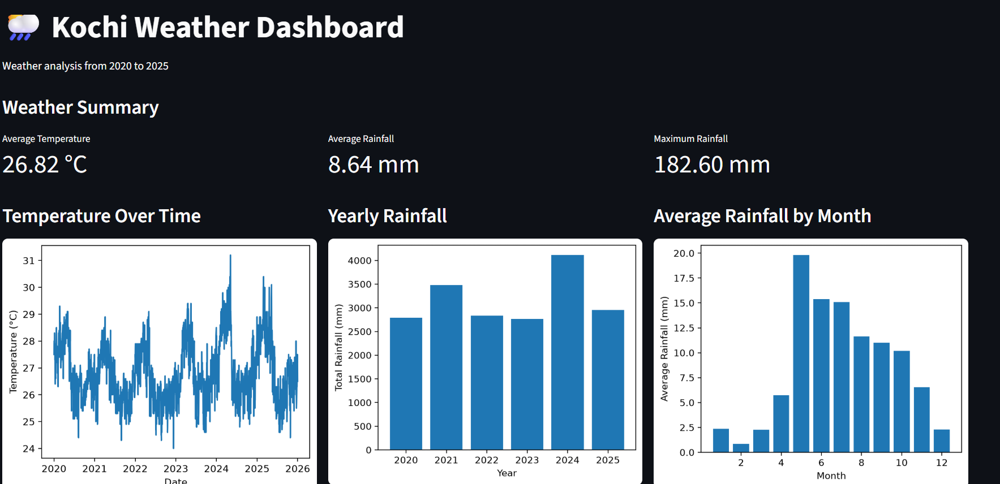
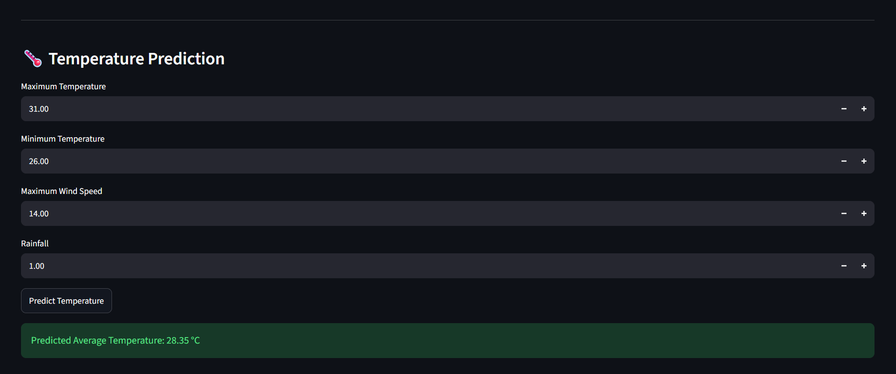

# Kochi Weather Analysis and Temperature Prediction

Analysis of daily weather data from Kochi from 2020 to 2025 to understand temperature and rainfall trends, with a machine learning model for average temperature prediction.

## Goal

The goal of this project is to analyze weather patterns in Kochi and understand how temperature and rainfall change across different months and years. A Linear Regression model is also used to predict average temperature using other weather conditions.

## Data

- Source: weather_raw.csv
- Location: Kochi
- Rows: 2,192 daily records
- Time range: 2020–2025
- Key columns: date, temp_mean, temp_max, temp_min, wind_max, rain

## Tools Used

- Python
- Pandas
- Matplotlib
- Scikit-learn
- Joblib
- Streamlit
- Jupyter Notebook

## Project Structure

```text
weather_data_Analysis/
├── weather_raw.csv
├── explore.ipynb
├── app.py
├── temp_model.pkl
├── images/
│   ├── dashboard1.png
│   └── dashboard2.png
└── README.md
```

## How to Run

### 1. Install the required libraries

Open the terminal in the project folder and run:


pip install pandas matplotlib scikit-learn joblib streamlit


### 2. Run the Streamlit dashboard


streamlit run app.py


### 3. Open the dashboard

Streamlit will show a local URL in the terminal. Open that URL in your browser.

## Key Findings

- The overall average temperature was 26.82°C.
- 2024 was the warmest year, with an average temperature of about 27.15°C.
- 2024 was the wettest year, with about 4115.5 mm of total rainfall.
- May had the highest average monthly rainfall, about 19.80 mm.
- The highest recorded temperature was 35.1°C on 27 February 2024.
- The highest recorded rainfall was 182.6 mm on 22 May 2024.

## Machine Learning

A Linear Regression model was used to predict average temperature.

### Input Features

- Maximum temperature
- Minimum temperature
- Maximum wind speed
- Rainfall

### Target

- Average temperature

### Model Performance

- MAE: 0.21°C
- R² Score:93.79%

## Dashboard

The Streamlit dashboard includes:

- Weather Summary
- Temperature Over Time
- Yearly Rainfall
- Average Rainfall by Month
- Temperature Prediction

## Screenshots

### Weather Dashboard



### Temperature Prediction



## Limitations and Future Improvements

- The dataset contains weather data only for Kochi.
- The machine learning model currently predicts average temperature.
- Future improvements could include using data from multiple cities and comparing different machine learning models.